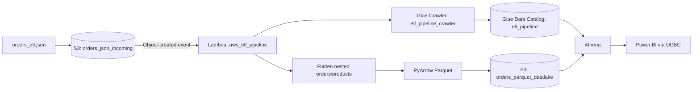

# Architecture



## S3 layout

```text
nitin-aws-etl/
├── orders_json_incoming/
├── orders_parquet_datalake/
└── athena-results/
```

The design separates incoming raw data, analytics-ready Parquet data, and Athena query-result files so non-Parquet query artifacts are never mixed into the Athena table location.
