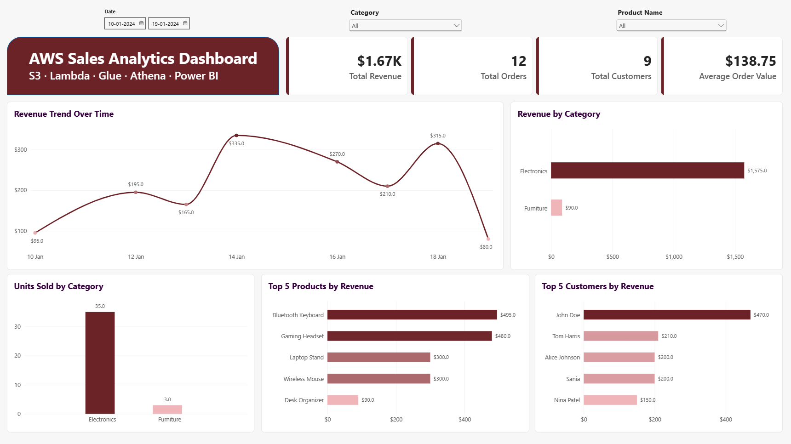
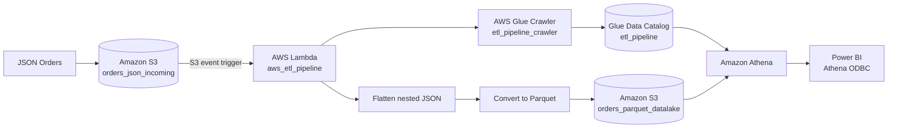

# ☁️ AWS Serverless ETL & Sales Analytics | S3 + Lambda + Glue + Athena + Power BI

An end-to-end cloud data engineering and business intelligence project that ingests nested JSON order data into **Amazon S3**, transforms it with **AWS Lambda**, stores analytics-ready **Parquet**, catalogs the dataset with **AWS Glue**, queries it through **Amazon Athena**, and connects the curated data to **Power BI** for reporting.

## 📊 Final Dashboard



### Dashboard KPIs

| KPI | Result |
|---|---:|
| **Total Revenue** | **$1.67K** |
| **Total Orders** | **12** |
| **Total Customers** | **9** |
| **Average Order Value** | **$138.75** |

The dashboard also includes:
- Revenue Trend Over Time
- Revenue by Category
- Units Sold by Category
- Top 5 Products by Revenue
- Top 5 Customers by Revenue
- Date, Category, and Product slicers

## 🧰 Tech Stack

**Amazon S3 · AWS Lambda · Python · pandas · PyArrow · AWS Glue Crawler · AWS Glue Data Catalog · Amazon Athena · Parquet · IAM · ODBC · Power BI · Power Query · DAX**

## 🏗️ Architecture



**AWS Region:** `us-east-2` (US East - Ohio)  
**S3 Bucket:** `nitin-aws-etl`  
**Lambda Function:** `aws_etl_pipeline`  
**Glue Crawler:** `etl_pipeline_crawler`  
**Glue Database:** `etl_pipeline`  
**Athena Table:** `orders_parquet_datalake`

## 🎯 Business Requirement

The source is nested JSON containing order, customer, and product arrays. The objective is to:

1. automatically process new JSON files arriving in S3;
2. flatten nested order/product structures into an analytical row-level dataset;
3. convert JSON into columnar Parquet for efficient querying;
4. discover and catalog the Parquet schema automatically;
5. query the S3 data with SQL through Athena;
6. expose the resulting dataset to Power BI for business analysis.

## 📥 Source Data

The sample source contains:

- **12 orders**
- **9 distinct customers**
- **23 order-product rows after flattening**
- customer details nested inside each order
- one or more products nested inside each order

The original sample file is available at:

**[Data/orders_etl.json](./Data/orders_etl.json)**

## ⚡ Lambda ETL

The S3 event invokes `aws_etl_pipeline`.

The Lambda function:

1. reads the uploaded JSON object from S3;
2. parses the nested JSON;
3. creates one analytical row for each product within each order;
4. builds a pandas DataFrame;
5. converts the DataFrame to Parquet using PyArrow;
6. writes a timestamped Parquet file to `orders_parquet_datalake/`;
7. starts the Glue crawler so the Data Catalog can be refreshed.

Source code:

**[Lambda/lambda_function.py](./Lambda/lambda_function.py)**

### Output grain

The transformed table has **one row per order-product line**, not one row per order.

Because order-level fields repeat for multi-product orders, dashboard revenue is intentionally calculated from:

```text
line_amount = price × quantity
```

rather than summing the repeated `total_amount` field.

## 🧭 AWS Glue & Athena

The Glue crawler scans the Parquet prefix and maintains the schema in the Glue Data Catalog.

Athena then queries the catalog table without loading the data into a traditional database.

Example:

```sql
SELECT *
FROM "etl_pipeline"."orders_parquet_datalake"
LIMIT 10;
```

Validation and troubleshooting queries are included in:

**[Athena/validation_queries.sql](./Athena/validation_queries.sql)**

## 🧹 Duplicate-file troubleshooting

During development, the Lambda function was executed multiple times against the same JSON source. Because each run created a new timestamped Parquet file, Athena read all files under the table location and returned duplicate blocks of data.

The issue was diagnosed with Athena's hidden `$path` column:

```sql
SELECT
    "$path" AS file_path,
    COUNT(*) AS row_count
FROM "etl_pipeline"."orders_parquet_datalake"
GROUP BY "$path";
```

Each duplicate file contained the same **23 rows**. The duplicate Parquet outputs were removed so the analytical dataset returned to the expected 23 rows.

This is an important data-lake lesson: **Athena reads every compatible file under the table location.**

## 🔌 Power BI Connection

Power BI connects to Athena using the **Amazon Athena ODBC 2.x driver**.

Final configuration:

```text
Region: us-east-2
Catalog: AwsDataCatalog
Database: etl_pipeline
Workgroup: primary
S3 query results: s3://nitin-aws-etl/athena-results/
```

The working ODBC connection explicitly passes:

```text
AwsRegion=us-east-2;
S3OutputLocation=s3://nitin-aws-etl/athena-results/;
```

A dedicated IAM principal was used for programmatic Power BI access. **No AWS credentials or secret keys are stored in this repository.**

## 🧮 Power BI Measures

```DAX
Total Revenue =
SUM(orders_parquet_datalake[line_amount])

Total Orders =
DISTINCTCOUNT(orders_parquet_datalake[order_id])

Total Customers =
DISTINCTCOUNT(orders_parquet_datalake[customer_id])

Average Order Value =
DIVIDE(
    [Total Revenue],
    [Total Orders]
)

Total Units Sold =
SUM(orders_parquet_datalake[quantity])
```

The `line_amount` column is created in Power Query:

```powerquery
[price] * [quantity]
```

## 🔐 IAM

A bucket-scoped IAM policy example for Athena/Power BI is included in:

**[IAM/PowerBI_Athena_S3_Access.json](./IAM/PowerBI_Athena_S3_Access.json)**

It allows only the S3 operations needed to:

- list the project bucket;
- read the Parquet data;
- read/write Athena query results.

## 📁 Repository Structure

```text
AWS-Serverless-ETL-Sales-Analytics/
├── README.md
├── .gitignore
├── Architecture/
│   └── README.md
├── Athena/
│   ├── README.md
│   └── validation_queries.sql
├── Data/
│   ├── README.md
│   └── orders_etl.json
├── IAM/
│   └── PowerBI_Athena_S3_Access.json
├── Images/
│   ├── Dashboard.png
│   └── README.md
├── Lambda/
│   └── lambda_function.py
└── PowerBI/
    ├── AWS Sales Analytics Dashboard.pbix
    └── README.md
```

## 🧠 Skills Demonstrated

- Event-driven cloud ETL
- Amazon S3 data-lake organization
- AWS Lambda and Python
- Nested JSON flattening
- pandas and PyArrow
- Parquet data engineering
- AWS Glue Crawler & Data Catalog
- Amazon Athena SQL
- IAM least-privilege concepts
- ODBC connectivity
- Power Query transformation
- DAX measures
- Power BI dashboard development
- Data-grain and duplicate-file troubleshooting

---

This project demonstrates the complete path from **raw nested JSON → serverless AWS ETL → Parquet data lake → catalog/query layer → Power BI analytics**.
